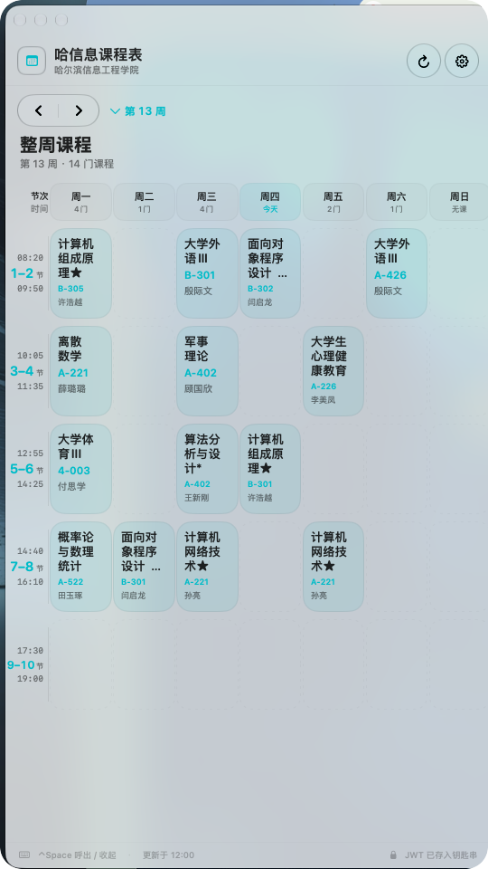

# 哈信息课程表

[](https://github.com/Micropue/greathiit-courseboard/actions/workflows/release.yml)
[](https://github.com/Micropue/greathiit-courseboard/releases)


根据“获取课程表”快捷指令制作的 macOS 原生课程表查看器。应用常驻菜单栏，
通过全局快捷键在屏幕左侧呼出，并以适合课表阅读的 9:16 长条窗口展示整周课程。

<p align="center">
  
</p>

## 功能

- 原生 SwiftUI 界面，使用 macOS 27 Liquid Glass 与系统材质，不使用渐变配色。
- 常驻菜单栏，不占用 Dock；再次按下全局快捷键即可收起。
- 默认使用 `⌥Space`，可在设置中录制并持久化新的全局快捷键。
- 以 9:16 长条窗口显示周一至周日的完整课表，并展示节次、起止时间、地点和教师。
- 点击课程可查看教学周、节次、时间、地点和教师等完整信息。
- 支持 20 个教学周切换；星期导航和教学周切换保持统一尺寸。
- 支持系统、蓝、紫、粉、红、橙、黄、绿、青和石墨共 10 种主题色。
- 支持通过 macOS 登录项实现开机自启；登录时静默驻留菜单栏，不主动弹出窗口。
- JWT 仅保存在 macOS 钥匙串，不写入源码、日志或课程缓存。
- 最近一次成功结果缓存到 Application Support，网络异常时仍可查看。
- 切换到其他应用时窗口保持显示，不会因失焦自动消失。

## 安装

从 [Releases](https://github.com/Micropue/greathiit-courseboard/releases)
下载最新的 `greathiit-courseboard-*.zip`，解压后将“哈信息课程表.app”
拖入“应用程序”目录。

当前发布包使用本地临时签名，未经过 Apple 公证。首次打开时如果被 Gatekeeper
拦截，请在 Finder 中右键应用并选择“打开”。也可以在终端执行：

```sh
xattr -dr com.apple.quarantine "/Applications/哈信息课程表.app"
```

自动构建发布为预发布版本，稳定版本请选择 `v*` 标签对应的 Release。

## 首次使用

首次打开后输入原“获取课程表”快捷指令所使用的 JWT。应用会把令牌写入
macOS 钥匙串；之后使用全局快捷键呼出即可刷新当前教学周的课程。

如果 `⌥Space` 已被其他应用占用，应用会自动尝试 `⌃⌥C`。也可以在
“设置 → 全局快捷键”中录制新的组合键。

“设置 → 开机自启”使用 `SMAppService` 注册系统登录项。如果系统要求确认，
请在“系统设置 → 通用 → 登录项”中允许哈信息课程表。建议先将应用移动到
“应用程序”目录再开启此功能。

## 从源码构建

需要 macOS 27 或更高版本，以及支持 macOS 27 SDK 的 Xcode 工具链。

```sh
swift test
./scripts/build-app.sh
```

构建产物位于：

```text
dist/哈信息课程表.app
```

可选地指定发布版本号：

```sh
APP_VERSION=1.1.0 APP_BUILD=3 ./scripts/build-app.sh
```

## 快捷指令逻辑

原快捷指令的关键步骤已还原到应用：

1. 输入教学周。
2. 请求 `https://api.greathiit.com/api/timetable/getDataWeek?week=<周次>`。
3. 使用快捷指令中保存的 JWT 作为 `Authorization` 请求头。
4. 读取响应中的 `data` 数组。
5. 解析每条课程的 `timeAdd`：
   - 取最后一个 `-` 后的片段；
   - 第 4 位为教学楼编码，`1` 映射为 A，`2` 映射为 B；
   - 第 5–7 位为教室；
   - 第 10 位为节次；
   - 第 11 位为星期。
6. 取出 `courseName`、`teacherName`，按星期和节次展示。

解析器也兼容响应中直接提供的 `weekday`、`period`、`buildingName`、
`classroomName` 等字段。

## 自动构建与发布

工作流位于 `.github/workflows/release.yml`。任意 push 都会触发以下流程：

1. 在 Xcode 27 runner 上运行 `swift test`。
2. 构建 `.app`，生成 ZIP 和 SHA-256 校验文件。
3. 发布到 GitHub Releases。

推送 `v*` 标签会发布正式版本；普通分支 push 会生成带独立构建编号的预发布版本。

## 隐私说明

- 本应用是非官方客户端，与哈尔滨信息工程学院没有隶属关系。
- JWT 只保存在本机钥匙串中。
- 课程数据仅从学校接口获取，并缓存在本机 Application Support 目录。
- 应用不包含统计、遥测或第三方上传逻辑。

## 许可证

本项目使用 [MIT License](LICENSE)。
